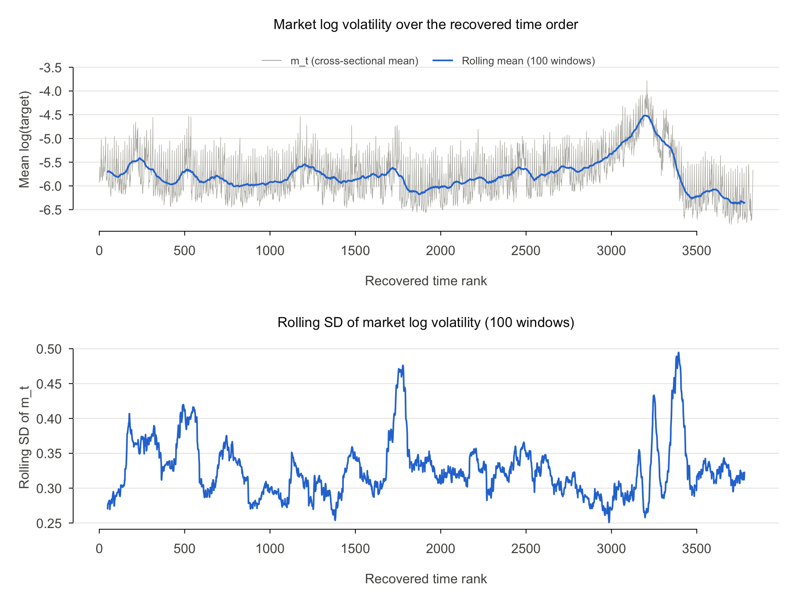
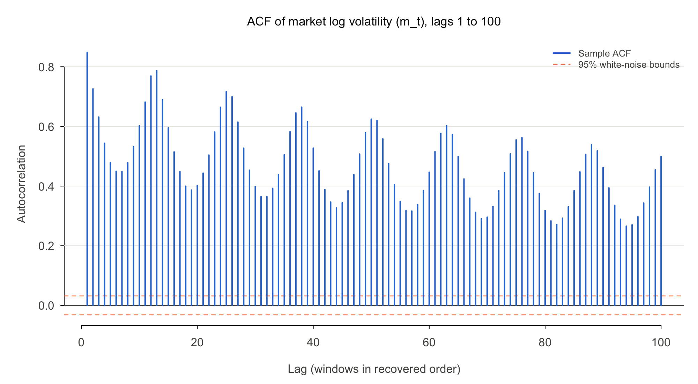
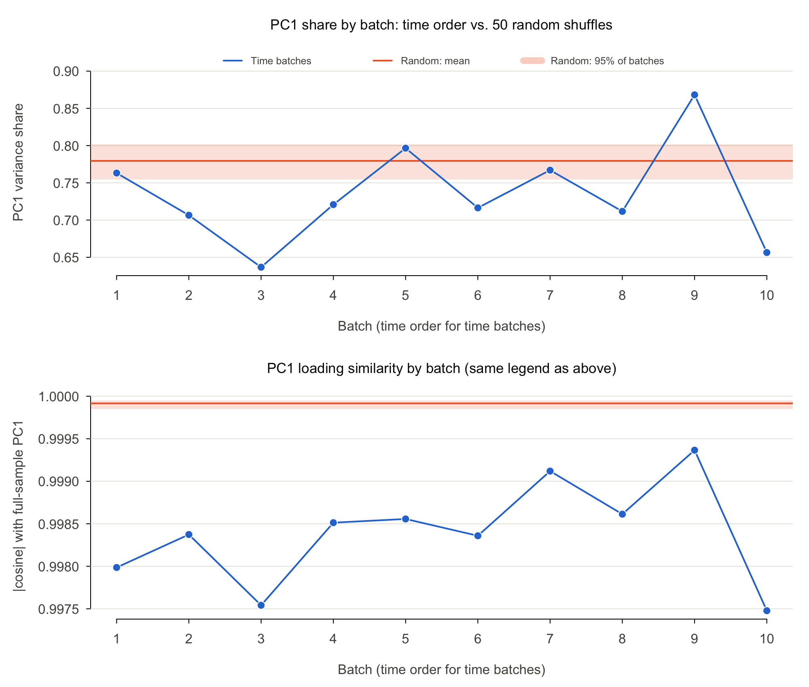

# Can the 3,830 time windows be treated as replicates?

Our professor asked us to check this before running PCA or factor analysis. Windows can be treated as replicates if they are (1) stationary and (2) only weakly dependent over time.

## Summary

**The windows should not be treated as independent replicates, but the common factor still looks real. The evidence best supports path B, with mixed results.**

- **Stationarity:** Not as they stand. ADF and KPSS both reject for market volatility and for all 112 stocks, which points to level shifts rather than a random walk.
- **Dependence:** Not weak. The market series has a lag-1 autocorrelation of 0.848, and it stays above 0.26 through lag 100. Its effective sample size is about 68 to 249, not 3,830.
- **Common factor:** PC1 explains 78.0% of the variance on raw data and still 74.4% after removing level shifts. Its loadings are nearly the same in every period.

## Data

All numbers come from the real Kaggle files. `Y` is log(target) with 3,830 windows and 112 stocks, and `m_t` is the mean of log(target) across stocks in window `t`.

| Item | Value |
| --- | --- |
| Rows in `train.csv` | 428,932 |
| Cells in the full matrix | 428,960 |
| Missing cells | 28 |
| Missing cells by stock | stock 13: 1, stock 38: 15, stock 75: 1, stock 80: 10, stock 100: 1 |

## Part 1: Recovering the time order

We estimated each stock's tick size in each window, converted it to a real price level (0.01 / tick size), and ordered the windows so that neighbors have similar price vectors. **Volatility was not used to build the order.**

### Building the order

| Item | Value |
| --- | --- |
| Tick estimates | 428,932 |
| Book price storage type | Float32 |
| Tick size: smallest, median, largest | 2.742e-06, 7.546e-05, 1.817e-03 |
| Median price per stock: lowest, median, highest | $7.71, $128.17, $3,106.89 |
| Price matrix size | 3,830 x 112 |
| Cells filled with the stock's median | 28 of 428,960, across 5 stocks |
| Spectral embedding neighbors (scikit-learn default) | 383 |

| Ordering step | Total path length | 2-opt passes |
| --- | --- | --- |
| Spectral embedding only | 7,028.5 | |
| Nearest-neighbor chain only | 1,916.9 | |
| Nearest-neighbor chain, then 2-opt | 1,694.2 | 16 |
| **Spectral embedding, then 2-opt (chosen, shortest path)** | **1,675.3** | 13 |

The two refined orders agree closely: the absolute rank correlation between them is 0.9814.

### Validating the order

| Check | Recovered order | 100 random orders: mean | 100 random orders: 95% range |
| --- | --- | --- | --- |
| Mean distance between consecutive windows | 0.438 | 13.571 | 13.437 to 13.707 |
| Lag-1 autocorrelation of `m_t` | 0.848 | -0.001 | -0.030 to 0.023 |

Consecutive windows are 3.2% as far apart as in a random order. Volatility is strongly autocorrelated only under the recovered order, which is evidence that the order is real.

**What cannot be identified:** the direction (forward or backward) and the gaps between windows (for example, overnight). `time_rank` is an ordering, not a clock. All "lags" in this report count windows, not minutes.

### Could volatility have leaked into the order?

Volatility is not an input, but it could leak in through the tick estimate: a quiet window visits fewer price levels and could miss the true tick. The prices are also stored as `Float32`, whose rounding matters most for high-priced stocks with very small ticks. We added these checks, and they do not support a meaningful leak:

| Extra check | Result |
| --- | --- |
| Cells off by a factor of 1.5 or more from nearby windows | 11 of 428,960 |
| Correlation of `m_t` with the mean signed price residual | -0.082 |
| Correlation of `m_t` with the mean absolute price residual | 0.685 |
| Lag-1 autocorrelation with the order built only from the lower-priced 56 stocks | 0.846 |
| Lag-1 autocorrelation with the order built only from the higher-priced 56 stocks | 0.831 |
| Rank agreement between those two orders | 0.99999 |

The 0.68 correlation needs care. Prices really do move more when volatility is high, so this is expected, but it cannot rule out a small effect by itself. The other checks are the stronger evidence, because orders built from two separate sets of stocks almost exactly match.

## Part 2: Stationarity and dependence

### Step 1: Visual check

Figure: `figures/stationarity_market_logrv.png`

| Item | Value |
| --- | --- |
| `m_t` mean and SD | -5.762 and 0.473 |
| Rolling mean (window = 100): lowest and highest | -6.376 and -4.516 |
| Rolling SD (window = 100): lowest and highest | 0.251 and 0.495 |
| Time rank at the highest rolling mean | 3197 |

The series has no steady trend, but its level clearly moves. The largest shift is the rise and fall around rank 3197, followed by the lowest levels in the sample.

### Step 2: ADF and KPSS tests

| Series | ADF statistic | ADF p-value | KPSS statistic | KPSS p-value | Result |
| --- | --- | --- | --- | --- | --- |
| `m_t` | -4.572 | at most 0.01 | 1.976 | at most 0.01 | Possible structural breaks |

| 112 stocks | Value |
| --- | --- |
| ADF rejects at 5% | 100.0% |
| KPSS rejects at 5% | 100.0% |

| Classification | ADF | KPSS | Stocks |
| --- | --- | --- | --- |
| Stationary | Rejects | Does not reject | 0 |
| Possible structural breaks | Rejects | Rejects | 112 |
| Inconclusive | Does not reject | Does not reject | 0 |
| Nonstationary | Does not reject | Rejects | 0 |

Three cautions apply:

- The `tseries` p-values are table limits. ADF is at its 0.01 limit for 105 stocks, and KPSS is at its limit for all 112.
- `adf.test` allows a linear trend, while the KPSS test here checks for a constant level. So the two tests do not assume exactly the same alternative.
- KPSS can over-reject on persistent series when its lag is short. With the longer lag option, it still rejects for `m_t` (statistic 0.728, lag 29, p = 0.011) and for 102 of 112 stocks (91.1%). This is an extra check.

Detailed results for each stock are in `report/per_stock_stationarity.md`.

### Step 3: Serial dependence

Figure: `figures/acf_market_logrv.png`

| Item | Value |
| --- | --- |
| AR(1) coefficient (SE) | 0.848 (0.0085) |
| ACF at lags 1, 5, 10, 20, 50, 100 | 0.848, 0.479, 0.602, 0.402, 0.624, 0.500 |
| Smallest ACF in lags 1 to 100 | 0.266 |
| White-noise bound | +/- 0.032 |
| Lags from 1 to 100 inside that bound | 0 |

| Effective sample size (n = 3,830) | Square root batches | Cube root batches |
| --- | --- | --- |
| Batch size | 61 | 15 |
| `m_t` ESS | 68.3 | 248.6 |
| `m_t` ESS as a share of n | 1.8% | 6.5% |
| Median ESS across 112 stocks | 74.5 | 265.1 |
| Middle 50% of stocks | 66.9 to 82.5 | 242.8 to 291.7 |
| Lowest and highest stock | 56.6 and 153.6 | 206.1 and 471.1 |
| Extra: `m_t` ESS with classic batch means (`r = 1`) | 111.6 | 395.8 |

These results use the `mcmcse` default (`r = 3`), a more cautious version of batch means. The square root result is the more trustworthy of the two, because batches of 15 windows are too short for dependence that lasts this long. Even batches of 61 may be too short, so these ESS values could still be too high.

**The dependence is not simple AR(1) (extra check).** An AR(1) with this coefficient would imply an ESS of 315 and a half-life of 4.2 windows. The ACF instead has repeating peaks at lags 13, 25, 38, 50, 63, 76, 88 (values 0.787, 0.717, 0.665, 0.624, 0.603, 0.563, 0.538). The strongest repeating period is 12.67 windows. This could be a time-of-day pattern if about 12 or 13 windows are sampled per trading day, but the data has no clock times, so we cannot confirm that.

### Step 4: Is the covariance structure stable over time?

Each batch has 383 windows. The random columns are averaged over 50 shuffles.

Figure: `figures/batch_pca_stability.png`. Table: `report/batch_pca_stability.md`.

| Batch | Time: PC1 share | Time: absolute cosine | Random: PC1 share | Random: absolute cosine |
| --- | --- | --- | --- | --- |
| 1 | 0.763 | 0.9980 | 0.781 | 0.9999 |
| 2 | 0.706 | 0.9984 | 0.779 | 0.9999 |
| 3 | 0.637 | 0.9975 | 0.781 | 0.9999 |
| 4 | 0.721 | 0.9985 | 0.777 | 0.9999 |
| 5 | 0.797 | 0.9986 | 0.780 | 0.9999 |
| 6 | 0.716 | 0.9984 | 0.779 | 0.9999 |
| 7 | 0.767 | 0.9991 | 0.780 | 0.9999 |
| 8 | 0.712 | 0.9986 | 0.777 | 0.9999 |
| 9 | 0.868 | 0.9994 | 0.780 | 0.9999 |
| 10 | 0.656 | 0.9975 | 0.780 | 0.9999 |

| Summary | Time batches | Random batches |
| --- | --- | --- |
| PC1 share: mean | 0.734 | 0.779 |
| PC1 share: SD across batches | 0.0676 | 0.0128 |
| PC1 share: lowest and highest | 0.637 and 0.868 | 0.732 and 0.812 |
| Absolute cosine: mean | 0.9984 | 0.9999 |
| Absolute cosine: SD across batches | 0.000605 | 0.000024 |
| Absolute cosine: lowest and highest | 0.99748 and 0.99937 | 0.99977 and 0.99996 |

- **The strength of the factor changes over time.** The SD of the PC1 share across time batches is 5.3 times the random baseline, and 0 of 50 shuffles varied as much.
- **The factor's direction is very stable.** The cosine varies 24.8 times more than the random baseline, but it never falls below 0.9975. This difference is statistically clear but very small in practical terms.
- **Stronger factor in higher-volatility periods (extra check).** Across the 10 batches, PC1 share and mean `m_t` have a correlation of 0.754. With only 10 batches, this is a rough indication only.

### Step 5: Do level shifts inflate PC1?

| Data | PC1 share |
| --- | --- |
| (a) Raw log(target) | 0.7797 |
| (b) Demeaned within 10 time batches | 0.7444 |
| Drop from (a) to (b) | 3.53 percentage points (4.5% of the raw share) |
| Extra: demeaned within random batches, mean of 50 shuffles | 0.7798 |
| Extra: absolute cosine between raw and demeaned PC1 | 0.9995 |
| Extra: share of `m_t` variance between time batches | 37.9% |

Level shifts are real, since 37.9% of the variance of `m_t` lies between batches. But they explain only a small part of PC1. **This is a small drop, so most of the common factor is co-movement within periods.** Batches of 383 windows only remove slow shifts, so faster shifts remain in this 74.4%.

### Step 6: Batch means standard errors

We used the first 3 PC scores from the full-sample PCA and formed `Y_t`, the vech of their outer product, which has 6 dimensions.

The number of batches must exceed the dimension, or the covariance estimate is singular. This is why we reduce to 3 PCs: with all 112 stocks, the vech would have 6,328 dimensions, far more than the batches available.

| Item | Value |
| --- | --- |
| Method | `mcse.multi(method = "bm")`, Lugsail bm with r = 3 |
| Batch size used | 83 |
| Number of batches | 46 |
| Batches exceed dimension (6) | Yes |
| Adjustment applied to the covariance matrix | No |
| Multivariate ESS | 82.6 |
| Multivariate ESS as a share of n | 2.2% |
| `minESS` for 5% precision, for reference | 8,708 |

**Estimated covariance matrix of the batch means (`cov`):**

| | s1s1 | s1s2 | s1s3 | s2s2 | s2s3 | s3s3 |
| --- | --- | --- | --- | --- | --- | --- |
| s1s1 | 1,464,113.3 | 172,270.5 | -7,224.5 | 14,673.8 | -4,054.5 | -1,841.2 |
| s1s2 | 172,270.5 | 31,622.6 | -4,255.1 | 1,595.1 | -703.2 | -391.3 |
| s1s3 | -7,224.5 | -4,255.1 | 4,445.9 | -648.7 | 263.1 | -225.6 |
| s2s2 | 14,673.8 | 1,595.1 | -648.7 | 1,099.5 | 200.5 | -107.8 |
| s2s3 | -4,054.5 | -703.2 | 263.1 | 200.5 | 280.5 | -163.5 |
| s3s3 | -1,841.2 | -391.3 | -225.6 | -107.8 | -163.5 | 419.2 |

**Means with standard errors.** The means of `s1s1`, `s2s2`, and `s3s3` are the PC variances, and the other means are zero because PC scores are uncorrelated.

| Term | Mean | Batch means SE | SE assuming independent windows | Ratio |
| --- | --- | --- | --- | --- |
| s1s1 | 87.309 | 19.552 | 2.191 | 8.9 |
| s1s2 | 0.000 | 2.873 | 0.315 | 9.1 |
| s1s3 | 0.000 | 1.077 | 0.194 | 5.5 |
| s2s2 | 2.980 | 0.536 | 0.064 | 8.3 |
| s2s3 | 0.000 | 0.271 | 0.034 | 7.9 |
| s3s3 | 1.765 | 0.331 | 0.036 | 9.3 |

Ignoring the dependence would make the SE of PC1's variance about 8.9 times too small. Dividing by 112 stocks, the batch means SE of the PC1 share is about 0.175. This is a wide margin. It treats the loadings as fixed and rests on few effective observations, so read it as a rough measure of uncertainty, not a precise interval.

### Extra check: Can the cycle be removed?

We did not plan this check. We added it because of the repeating ACF peaks. It removes 3 sine and cosine pairs at the 12.67-window period from every stock, with and without batch demeaning.

| Measure on `m_t` | Original | Cycle removed | Batch means and cycle removed |
| --- | --- | --- | --- |
| Variance explained by what was removed | | 3.2% | 41.0% |
| Lag-1 ACF | 0.848 | 0.847 | 0.747 |
| ACF at lag 13 | 0.787 | 0.781 | 0.624 |
| ACF at lag 100 | 0.500 | 0.494 | 0.189 |
| Lags from 1 to 100 inside the white-noise bound | 0 | 0 | 13 |
| ESS, square root batches | 68.3 | 66.0 | 151.8 |
| ESS, cube root batches | 248.6 | 239.2 | 388.9 |
| ADF and KPSS classification | Possible structural breaks | Possible structural breaks | Stationary |
| PC1 share | 0.7797 | 0.7747 | 0.7352 |

- **Batch demeaning helps with stationarity.** After it, ADF rejects and KPSS does not, so `m_t` is classified as stationary. The p-values are at their table limits, and KPSS also does not reject with the longer lag (statistic 0.064).
- **A fixed-period cycle fit does not work.** It explains only 3.2% of the variance and barely changes the ACF. Either the cycle is not steady in rank order, or this simple model does not fit it. **We have not found a way to remove it yet.**
- **Dependence remains.** Even after both steps, the ESS is only 152 to 389.

## What this means

**Path B is the best fit: level shifts or regimes are present. Path A does not fit, because the dependence is not fast-decaying. Path C is not needed.**

| Path | Fit | Evidence |
| --- | --- | --- |
| (A) Roughly stationary, fast-decaying dependence | **No** | Lag-1 ACF is 0.848. No lag from 1 to 100 falls inside the white-noise bound. ESS is 1.8% to 6.5% of n. |
| (B) Level shifts or regimes | **Best fit** | Both tests reject for all 112 stocks. 37.9% of `m_t` variance is between batches. PC1 share ranges from 0.637 to 0.868. `m_t` is classified as stationary after batch demeaning. |
| (C) Strong nonstationarity | **No** | ADF rejects for all 112 stocks, so there is no sign of a random walk. PC1 loadings stay stable (cosine at least 0.9975). PC1 falls only 3.53 points after demeaning. |

The evidence is mixed in two ways:

- **Good news for the common factor.** A strong, stable PC1 remains after demeaning, so H1 still looks reasonable. Level shifts are not creating the factor.
- **Bad news for treating windows as replicates.** Batch demeaning does not fix the dependence. It also leaves a repeating cycle that we have not been able to remove.

### Recommended changes to the plan

1. Do not treat the windows as 3,830 independent observations. As a rough guide, we have about 68 to 249 effective observations for the market series, and 83 for the first three PCs' covariance structure.
2. Run PCA and factor analysis on both raw and batch-demeaned data, and report PC1 as a range across periods, not as one number.
3. Use batch means standard errors for any uncertainty about PC-based results. Standard formulas that assume independent windows will be too small.
4. Use time-ordered blocks for model validation, with gaps long enough to cover the dependence. Random K-fold would mix neighboring, highly correlated windows.
5. Study the repeating cycle before modeling. The next step is to find a method that does not assume a fixed period, such as demeaning over much shorter blocks.

### Limits of these results

- The order is recovered, not known. Direction and gaps cannot be identified, so lags count windows, not clock time.
- Any errors in the order would most likely weaken the measured dependence, so the true dependence may be at least this strong. We have not tested this directly.
- The ACF is affected by both level shifts and the cycle, so one AR(1) coefficient does not summarize it.
- ESS depends on the batch size and the method, as the table in Step 3 shows.
- `m_t` is an average across stocks. Stock-level results are in `report/per_stock_stationarity.md`.

## Choices we made

- **Data:** We unzipped the Kaggle file into `data/raw/`, which was empty. No data is committed.
- **Order refinement:** We ran the 2-opt step from both the nearest-neighbor chain and the spectral order, and kept the shorter path. This choice used only price distances.
- **Missing cells in tests:** ADF, KPSS, and ESS need complete series, so stocks with missing windows use their observed windows in order. For PCA steps only, missing cells are filled with column means.
- **Rolling statistics:** The rolling mean and SD are centered, because the direction of time is unknown.
- **Table format:** The batch table is Markdown because the repo ignores `*.csv`.
- **Seed:** All random steps use seed 5650.

## Files

| File | Contents |
| --- | --- |
| `figures/stationarity_market_logrv.png` | `m_t` with rolling mean and rolling SD |
| `figures/acf_market_logrv.png` | ACF of `m_t` to lag 100 |
| `figures/batch_pca_stability.png` | PC1 share and cosine by batch |
| `report/batch_pca_stability.md` | Batch table |
| `report/per_stock_stationarity.md` | ADF, KPSS, and ESS for each stock |
| `report/time_order_validation.json` | All Part 1 numbers |
| `report/stationarity_results.json` | All Part 2 numbers |
| `notebooks/02_time_order.ipynb`, `src/time_order.py` | Part 1 code |
| `R/04b_stationarity.R` | Part 2 code |
