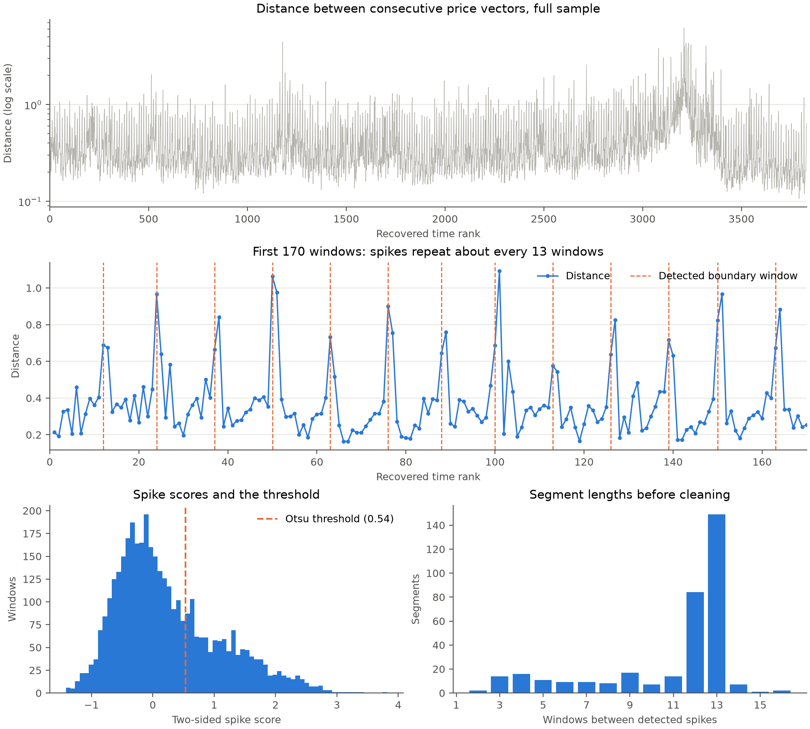
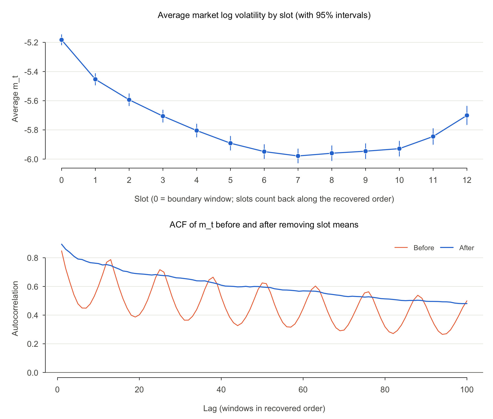
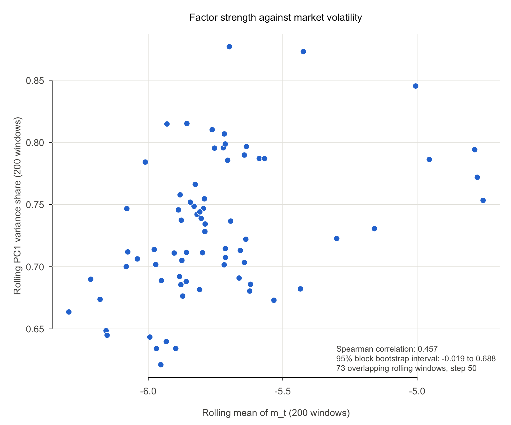

# Can the 3,830 time windows be treated as replicates?

Our professor asked us to check this before running PCA or factor analysis. Windows can be treated as replicates if they are (1) stationary and (2) only weakly dependent over time.

## Summary

**The windows should not be treated as independent replicates, but the common factor still looks real. The evidence best supports path B, with mixed results.**

- **Stationarity:** Not as they stand. ADF and KPSS both reject for market volatility and for all 112 stocks, which points to level shifts rather than a random walk.
- **Dependence:** Not weak. The market series has a lag-1 autocorrelation of 0.848, and it stays above 0.26 through lag 100. Its effective sample size is about 68 to 249, not 3,830.
- **Common factor:** PC1 explains 78.0% of the variance on raw data and still 74.4% after removing level shifts. Its loadings are nearly the same in every period.

**Update from the follow-up section:** The repeating cycle comes from trading days, and removing it does not fix the dependence. Only PC1 is stable over time; PC2 and PC3 are not. Two earlier statements are also corrected below: the SE of the PC1 share and the ESS after batch demeaning.

## Data

All numbers come from the real Kaggle files. `Y` is log(target) with 3,830 windows and 112 stocks, and `m_t` is the mean of log(target) across stocks in window `t`.

| Item | Value |
| --- | --- |
| Rows in `train.csv` | 428,932 |
| Cells in the full matrix | 428,960 |
| Missing cells | 28 |
| Missing cells by stock | stock 13: 1, stock 38: 15, stock 75: 1, stock 80: 10, stock 100: 1 |

## Part 1: Recovering the time order

We estimated each stock's tick size in each window, converted it to a real price level (0.01 / tick size), and ordered the windows so that neighbors have similar price vectors. **Volatility was not used to build the order.**

### Building the order

| Item | Value |
| --- | --- |
| Tick estimates | 428,932 |
| Book price storage type | Float32 |
| Tick size: smallest, median, largest | 2.742e-06, 7.546e-05, 1.817e-03 |
| Median price per stock: lowest, median, highest | $7.71, $128.17, $3,106.89 |
| Price matrix size | 3,830 x 112 |
| Cells filled with the stock's median | 28 of 428,960, across 5 stocks |
| Spectral embedding neighbors (scikit-learn default) | 383 |

| Ordering step | Total path length | 2-opt passes |
| --- | --- | --- |
| Spectral embedding only | 7,028.5 | |
| Nearest-neighbor chain only | 1,916.9 | |
| Nearest-neighbor chain, then 2-opt | 1,694.2 | 16 |
| **Spectral embedding, then 2-opt (chosen, shortest path)** | **1,675.3** | 13 |

The two refined orders agree closely: the absolute rank correlation between them is 0.9814.

### Validating the order

| Check | Recovered order | 100 random orders: mean | 100 random orders: 95% range |
| --- | --- | --- | --- |
| Mean distance between consecutive windows | 0.438 | 13.571 | 13.437 to 13.707 |
| Lag-1 autocorrelation of `m_t` | 0.848 | -0.001 | -0.030 to 0.023 |

Consecutive windows are 3.2% as far apart as in a random order. Volatility is strongly autocorrelated only under the recovered order, which is evidence that the order is real.

**What cannot be identified:** the direction (forward or backward) and the gaps between windows (for example, overnight). `time_rank` is an ordering, not a clock. (Prices alone cannot identify direction, but the follow-up section finds that the shape of the daily volatility pattern suggests the order runs backward in time.) All "lags" in this report count windows, not minutes.

### Could volatility have leaked into the order?

Volatility is not an input, but it could leak in through the tick estimate: a quiet window visits fewer price levels and could miss the true tick. The prices are also stored as `Float32`, whose rounding matters most for high-priced stocks with very small ticks. We added these checks, and they do not support a meaningful leak:

| Extra check | Result |
| --- | --- |
| Cells off by a factor of 1.5 or more from nearby windows | 11 of 428,960 |
| Correlation of `m_t` with the mean signed price residual | -0.082 |
| Correlation of `m_t` with the mean absolute price residual | 0.685 |
| Lag-1 autocorrelation with the order built only from the lower-priced 56 stocks | 0.846 |
| Lag-1 autocorrelation with the order built only from the higher-priced 56 stocks | 0.831 |
| Rank agreement between those two orders | 0.99999 |

The 0.68 correlation needs care. Prices really do move more when volatility is high, so this is expected, but it cannot rule out a small effect by itself. The other checks are the stronger evidence, because orders built from two separate sets of stocks almost exactly match.

## Part 2: Stationarity and dependence

### Step 1: Visual check

Figure: `figures/stationarity_market_logrv.png`

| Item | Value |
| --- | --- |
| `m_t` mean and SD | -5.762 and 0.473 |
| Rolling mean (window = 100): lowest and highest | -6.376 and -4.516 |
| Rolling SD (window = 100): lowest and highest | 0.251 and 0.495 |
| Time rank at the highest rolling mean | 3197 |

The series has no steady trend, but its level clearly moves. The largest shift is the rise and fall around rank 3197, followed by the lowest levels in the sample.

### Step 2: ADF and KPSS tests

| Series | ADF statistic | ADF p-value | KPSS statistic | KPSS p-value | Result |
| --- | --- | --- | --- | --- | --- |
| `m_t` | -4.572 | at most 0.01 | 1.976 | at most 0.01 | Possible structural breaks |

| 112 stocks | Value |
| --- | --- |
| ADF rejects at 5% | 100.0% |
| KPSS rejects at 5% | 100.0% |

| Classification | ADF | KPSS | Stocks |
| --- | --- | --- | --- |
| Stationary | Rejects | Does not reject | 0 |
| Possible structural breaks | Rejects | Rejects | 112 |
| Inconclusive | Does not reject | Does not reject | 0 |
| Nonstationary | Does not reject | Rejects | 0 |

Three cautions apply:

- The `tseries` p-values are table limits. ADF is at its 0.01 limit for 105 stocks, and KPSS is at its limit for all 112.
- `adf.test` allows a linear trend, while the KPSS test here checks for a constant level. So the two tests do not assume exactly the same alternative.
- KPSS can over-reject on persistent series when its lag is short. With the longer lag option, it still rejects for `m_t` (statistic 0.728, lag 29, p = 0.011) and for 102 of 112 stocks (91.1%). This is an extra check.

Detailed results for each stock are in `report/per_stock_stationarity.md`.

### Step 3: Serial dependence

Figure: `figures/acf_market_logrv.png`

| Item | Value |
| --- | --- |
| AR(1) coefficient (SE) | 0.848 (0.0085) |
| ACF at lags 1, 5, 10, 20, 50, 100 | 0.848, 0.479, 0.602, 0.402, 0.624, 0.500 |
| Smallest ACF in lags 1 to 100 | 0.266 |
| White-noise bound | +/- 0.032 |
| Lags from 1 to 100 inside that bound | 0 |

| Effective sample size (n = 3,830) | Square root batches | Cube root batches |
| --- | --- | --- |
| Batch size | 61 | 15 |
| `m_t` ESS | 68.3 | 248.6 |
| `m_t` ESS as a share of n | 1.8% | 6.5% |
| Median ESS across 112 stocks | 74.5 | 265.1 |
| Middle 50% of stocks | 66.9 to 82.5 | 242.8 to 291.7 |
| Lowest and highest stock | 56.6 and 153.6 | 206.1 and 471.1 |
| Extra: `m_t` ESS with classic batch means (`r = 1`) | 111.6 | 395.8 |

These results use the `mcmcse` default (`r = 3`), a more cautious version of batch means. The square root result is the more trustworthy of the two, because batches of 15 windows are too short for dependence that lasts this long. Even batches of 61 may be too short, so these ESS values could still be too high.

**The dependence is not simple AR(1) (extra check).** An AR(1) with this coefficient would imply an ESS of 315 and a half-life of 4.2 windows. The ACF instead has repeating peaks at lags 13, 25, 38, 50, 63, 76, 88 (values 0.787, 0.717, 0.665, 0.624, 0.603, 0.563, 0.538). The strongest repeating period is 12.67 windows. This could be a time-of-day pattern if about 12 or 13 windows are sampled per trading day, but the data has no clock times, so we cannot confirm that directly. The follow-up section tests this and supports it.

### Step 4: Is the covariance structure stable over time?

Each batch has 383 windows. The random columns are averaged over 50 shuffles.

Figure: `figures/batch_pca_stability.png`. Table: `report/batch_pca_stability.md`.

| Batch | Time: PC1 share | Time: absolute cosine | Random: PC1 share | Random: absolute cosine |
| --- | --- | --- | --- | --- |
| 1 | 0.763 | 0.9980 | 0.781 | 0.9999 |
| 2 | 0.706 | 0.9984 | 0.779 | 0.9999 |
| 3 | 0.637 | 0.9975 | 0.781 | 0.9999 |
| 4 | 0.721 | 0.9985 | 0.777 | 0.9999 |
| 5 | 0.797 | 0.9986 | 0.780 | 0.9999 |
| 6 | 0.716 | 0.9984 | 0.779 | 0.9999 |
| 7 | 0.767 | 0.9991 | 0.780 | 0.9999 |
| 8 | 0.712 | 0.9986 | 0.777 | 0.9999 |
| 9 | 0.868 | 0.9994 | 0.780 | 0.9999 |
| 10 | 0.656 | 0.9975 | 0.780 | 0.9999 |

| Summary | Time batches | Random batches |
| --- | --- | --- |
| PC1 share: mean | 0.734 | 0.779 |
| PC1 share: SD across batches | 0.0676 | 0.0128 |
| PC1 share: lowest and highest | 0.637 and 0.868 | 0.732 and 0.812 |
| Absolute cosine: mean | 0.9984 | 0.9999 |
| Absolute cosine: SD across batches | 0.000605 | 0.000024 |
| Absolute cosine: lowest and highest | 0.99748 and 0.99937 | 0.99977 and 0.99996 |

- **The strength of the factor changes over time.** The SD of the PC1 share across time batches is 5.3 times the random baseline, and 0 of 50 shuffles varied as much.
- **The factor's direction is very stable.** The cosine varies 24.8 times more than the random baseline, but it never falls below 0.9975. This difference is statistically clear but very small in practical terms.
- **Stronger factor in higher-volatility periods (extra check).** Across the 10 batches, PC1 share and mean `m_t` have a correlation of 0.754. With only 10 batches, this is a rough indication only.

### Step 5: Do level shifts inflate PC1?

| Data | PC1 share |
| --- | --- |
| (a) Raw log(target) | 0.7797 |
| (b) Demeaned within 10 time batches | 0.7444 |
| Drop from (a) to (b) | 3.53 percentage points (4.5% of the raw share) |
| Extra: demeaned within random batches, mean of 50 shuffles | 0.7798 |
| Extra: absolute cosine between raw and demeaned PC1 | 0.9995 |
| Extra: share of `m_t` variance between time batches | 37.9% |

Level shifts are real, since 37.9% of the variance of `m_t` lies between batches. But they explain only a small part of PC1. **This is a small drop, so most of the common factor is co-movement within periods.** The follow-up section shows that part of this co-movement is the intraday pattern that all stocks share. Batches of 383 windows only remove slow shifts, so faster shifts remain in this 74.4%.

### Step 6: Batch means standard errors

We used the first 3 PC scores from the full-sample PCA and formed `Y_t`, the vech of their outer product, which has 6 dimensions.

The number of batches must exceed the dimension, or the covariance estimate is singular. This is why we reduce to 3 PCs: with all 112 stocks, the vech would have 6,328 dimensions, far more than the batches available.

| Item | Value |
| --- | --- |
| Method | `mcse.multi(method = "bm")`, Lugsail bm with r = 3 |
| Batch size used | 83 |
| Number of batches | 46 |
| Batches exceed dimension (6) | Yes |
| Adjustment applied to the covariance matrix | No |
| Multivariate ESS | 82.6 |
| Multivariate ESS as a share of n | 2.2% |
| `minESS` for 5% precision, for reference | 8,708 |

**Estimated covariance matrix of the batch means (`cov`):**

| | s1s1 | s1s2 | s1s3 | s2s2 | s2s3 | s3s3 |
| --- | --- | --- | --- | --- | --- | --- |
| s1s1 | 1,464,113.3 | 172,270.5 | -7,224.5 | 14,673.8 | -4,054.5 | -1,841.2 |
| s1s2 | 172,270.5 | 31,622.6 | -4,255.1 | 1,595.1 | -703.2 | -391.3 |
| s1s3 | -7,224.5 | -4,255.1 | 4,445.9 | -648.7 | 263.1 | -225.6 |
| s2s2 | 14,673.8 | 1,595.1 | -648.7 | 1,099.5 | 200.5 | -107.8 |
| s2s3 | -4,054.5 | -703.2 | 263.1 | 200.5 | 280.5 | -163.5 |
| s3s3 | -1,841.2 | -391.3 | -225.6 | -107.8 | -163.5 | 419.2 |

**Means with standard errors.** The means of `s1s1`, `s2s2`, and `s3s3` are the PC variances, and the other means are zero because PC scores are uncorrelated.

| Term | Mean | Batch means SE | SE assuming independent windows | Ratio |
| --- | --- | --- | --- | --- |
| s1s1 | 87.309 | 19.552 | 2.191 | 8.9 |
| s1s2 | 0.000 | 2.873 | 0.315 | 9.1 |
| s1s3 | 0.000 | 1.077 | 0.194 | 5.5 |
| s2s2 | 2.980 | 0.536 | 0.064 | 8.3 |
| s2s3 | 0.000 | 0.271 | 0.034 | 7.9 |
| s3s3 | 1.765 | 0.331 | 0.036 | 9.3 |

Ignoring the dependence would make the SE of PC1's variance about 8.9 times too small. **Correction:** An earlier version of this report divided this SE by 112 stocks to get an SE of about 0.175 for the PC1 share. That overstates the uncertainty, because it ignores that volatile windows also raise the total variance in the share's denominator. Item 8 in the follow-up section gives better estimates.

### Extra check: Can the cycle be removed?

We did not plan this check. We added it because of the repeating ACF peaks. It removes 3 sine and cosine pairs at the 12.67-window period from every stock, with and without batch demeaning.

| Measure on `m_t` | Original | Cycle removed | Batch means and cycle removed |
| --- | --- | --- | --- |
| Variance explained by what was removed | | 3.2% | 41.0% |
| Lag-1 ACF | 0.848 | 0.847 | 0.747 |
| ACF at lag 13 | 0.787 | 0.781 | 0.624 |
| ACF at lag 100 | 0.500 | 0.494 | 0.189 |
| Lags from 1 to 100 inside the white-noise bound | 0 | 0 | 13 |
| ESS, square root batches | 68.3 | 66.0 | 151.8 |
| ESS, cube root batches | 248.6 | 239.2 | 388.9 |
| ADF and KPSS classification | Possible structural breaks | Possible structural breaks | Stationary |
| PC1 share | 0.7797 | 0.7747 | 0.7352 |

- **Batch demeaning helps with stationarity.** After it, ADF rejects and KPSS does not, so `m_t` is classified as stationary. This is partly mechanical, because demeaning removes the level shifts that KPSS detects. The p-values are at their table limits, and KPSS also does not reject with the longer lag (statistic 0.064).
- **A fixed-period cycle fit does not work.** It explains only 3.2% of the variance and barely changes the ACF. Either the cycle is not steady in rank order, or this simple model does not fit it. **The follow-up section shows that removing slot means does remove it.**
- **Dependence remains.** Even after both steps, the lag-1 ACF is 0.747.
- **Correction:** Do not use the ESS values in the last column of this table (151.8 and 388.9). They come from batch means on a series that was demeaned within batches, which makes them too high. Item 6 in the follow-up section explains why.

## What this means

**Path B is the best fit: level shifts or regimes are present. Path A does not fit, because the dependence is not fast-decaying. Path C is not needed.**

| Path | Fit | Evidence |
| --- | --- | --- |
| (A) Roughly stationary, fast-decaying dependence | **No** | Lag-1 ACF is 0.848. No lag from 1 to 100 falls inside the white-noise bound. ESS is 1.8% to 6.5% of n. |
| (B) Level shifts or regimes | **Best fit** | Both tests reject for all 112 stocks. 37.9% of `m_t` variance is between batches. PC1 share ranges from 0.637 to 0.868. `m_t` is classified as stationary after batch demeaning. |
| (C) Strong nonstationarity | **No** | ADF rejects for all 112 stocks, so there is no sign of a random walk. PC1 loadings stay stable (cosine at least 0.9975). PC1 falls only 3.53 points after demeaning. |

The evidence is mixed in two ways:

- **Good news for the common factor.** A strong, stable PC1 remains after demeaning, so H1 still looks reasonable. Level shifts are not creating the factor.
- **Bad news for treating windows as replicates.** Batch demeaning does not fix the dependence. The follow-up section also shows that the dependence remains after the intraday cycle is removed.

### Recommended changes to the plan

1. Do not treat the windows as 3,830 independent observations. As a rough guide, we have about 68 to 249 effective observations for the market series, and 83 for the first three PCs' covariance structure.
2. Run PCA and factor analysis on both raw and deseasonalized data, and report PC1 as a range across periods, not as one number.
3. Use batch means standard errors for any uncertainty about PC-based results. Standard formulas that assume independent windows will be too small.
4. Use time-ordered blocks for model validation, with gaps long enough to cover the dependence. Random K-fold would mix neighboring, highly correlated windows.
5. Use `slot` to handle the intraday pattern, as the follow-up section does. See that section for further changes.

### Limits of these results

- The order is recovered, not known. Direction and gaps cannot be identified, so lags count windows, not clock time.
- Any errors in the order would most likely weaken the measured dependence, so the true dependence may be at least this strong. We have not tested this directly.
- The ACF is affected by both level shifts and the cycle, so one AR(1) coefficient does not summarize it.
- ESS depends on the batch size and the method, as the table in Step 3 shows.
- `m_t` is an average across stocks. Stock-level results are in `report/per_stock_stationarity.md`.

## Follow-up: Trading days, the intraday pattern, and stability beyond PC1

This section tests where the repeating ACF cycle comes from and what remains once it is removed. Code: `notebooks/02b_day_boundaries.ipynb`, `src/day_slots.py`, and `R/04c_intraday_and_stability.R`. Numbers: `report/day_boundary_results.json` and `report/intraday_results.json`.

### Main results

- **The cycle comes from trading days.** Price jumps repeat about every 13 windows, and slots explain 67.6% of `m_t`'s variance within days.
- **Removing it does not fix the dependence.** The cycle disappears, but the ESS falls and ADF and KPSS still both reject. Slow day-to-day persistence is the main problem.
- **PC1 is stable in direction but not in strength.** PC2 and PC3 are not stable. Their subspace moves by about 71 degrees between time batches and the full sample, compared with about 14 degrees for random batches.

### Item 1: Do overnight gaps explain the cycle?

**Yes, the evidence supports the hypothesis.** We saved `data/processed/day_slots.parquet` with `time_id`, `day_id`, and `slot`. Boundaries were found from prices only, and volatility was used only afterward to check them.

Figure: `figures/consecutive_distance.png`

**Are there periodic spikes?** Yes. The strongest repeating period in the log distances is 12.68 windows, which implies about 302 days. The ACF of log distance is 0.647 at lag 13 and 0.563 at lag 25, against 0.045 at lag 19.

**How spikes were detected.** The spikes usually come in adjacent pairs around one window. A simple threshold on single distances therefore fails: its median segment is 1 window, and only 6.9% of its segments are 12-13 windows long. So we scored each window on the distances to both of its neighbors, each compared with a rolling median over 39 windows (3 times the period). The threshold (0.537) comes from Otsu's method, which needs no tuning.

**Segment lengths between spikes, before any cleaning:**

| Result | Value |
| --- | --- |
| Segments | 350 |
| Median length | 12 |
| Segments 12-13 windows long | **66.6%** |
| Segments exactly 13 windows long | 42.6% |
| Same share of 12-13 in 200 shuffled versions: mean | 5.3% |
| Same share of 12-13 in shuffled versions: 95% range | 3.3% to 7.4% |

| Segment length | Count |
| --- | --- |
| 2 | 2 |
| 3 | 14 |
| 4 | 16 |
| 5 | 11 |
| 6 | 9 |
| 7 | 9 |
| 8 | 8 |
| 9 | 17 |
| 10 | 7 |
| 11 | 14 |
| 12 | 84 |
| 13 | 149 |
| 14 | 7 |
| 15 | 1 |
| 16 | 2 |

About a third of the segments are not 12-13 windows long. Most of these are short, and many look like one day split by a false alarm (for example, 9 + 4).

**The result does not depend on one threshold.** It holds across moderate thresholds and fades when the threshold is so high that most days are missed:

| Threshold: median + k x MAD, k = | Threshold | Segments | Median length | Segments 12-13 windows long |
| --- | --- | --- | --- | --- |
| 1.0 | 0.80 | 332 | 13 | 73.2% |
| 1.5 | 1.17 | 308 | 13 | 79.2% |
| 2.0 | 1.55 | 259 | 13 | 74.5% |
| 2.5 | 1.93 | 159 | 13 | 49.7% |
| 3.0 | 2.31 | 74 | 38 | 25.7% |

**Building the days.** Neighboring segments that fit together within 14 windows were merged by removing the weaker boundary, which removed 46 of 351 boundaries. This step uses the typical length, so the lengths below cannot test the hypothesis. The test is the table above.

| Day table | Value |
| --- | --- |
| Days | 306 |
| Days with 12-13 windows | 88.6% |
| Windows in those days | 89.5% |

| Windows in a day | Days |
| --- | --- |
| 5 | 1 |
| 6 | 1 |
| 8 | 1 |
| 9 | 3 |
| 10 | 2 |
| 11 | 15 |
| 12 | 97 |
| 13 | 174 |
| 14 | 9 |
| 15 | 1 |
| 16 | 2 |

**Independent check with volatility:**

| Check | Result |
| --- | --- |
| `m_t` variance within days explained by slot | 67.6% |
| Same, with slots shuffled (200 times): highest | 1.0% |
| Full days whose volatility pattern matches the other days | 98.9% of 174 |
| Full days that match better when reversed | 4.0% |
| Full days with slot 0 more volatile than slot 1 | 98.3% |

**What this does not prove.** The data has no clock times, so "about 30 minutes apart" is an inference from 13 windows in a 390-minute day. Days with 12 windows may be missing one window, and we cannot tell which one, so some slots in those days may be off by one. Days with 5-10 windows could be shortened trading days or detection errors. We cannot tell which.

**Direction.** Slot 0 is the window between the two jumps. It is the most volatile slot, and volatility falls gradually from there until about slot 7. Slots count **backward** along the recovered order. Since markets are usually most volatile at the open and then calm down, this suggests that slot 0 is the market open and that **the recovered order runs backward in time**. This is strong evidence but not proof. If it is right, a slot number is its position in the trading day, and the two jumps are the open's own move and the overnight gap.

### Item 2: Removing the intraday pattern

We subtracted each stock's mean in each slot from log(target), then rebuilt `m_t`.

Figure: `figures/intraday_pattern.png`. The bottom panel shows the cycle disappearing.

| Slot | Windows | Average `m_t` | Average relative to its day |
| --- | --- | --- | --- |
| 0 | 306 | -5.183 | 0.575 |
| 1 | 306 | -5.453 | 0.304 |
| 2 | 306 | -5.593 | 0.164 |
| 3 | 306 | -5.706 | 0.052 |
| 4 | 306 | -5.804 | -0.047 |
| 5 | 305 | -5.891 | -0.131 |
| 6 | 304 | -5.949 | -0.186 |
| 7 | 304 | -5.979 | -0.216 |
| 8 | 303 | -5.960 | -0.195 |
| 9 | 300 | -5.946 | -0.175 |
| 10 | 298 | -5.929 | -0.154 |
| 11 | 283 | -5.845 | -0.072 |
| 12 | 186 | -5.701 | 0.080 |
| 13 | 12 | -5.217 | 0.260 |
| 14 | 3 | -5.039 | 0.140 |
| 15 | 2 | -5.091 | 0.220 |

Slots 13-15 have few windows, so we left them out of the plot. The plot's intervals treat windows in a slot as independent, so they are too narrow.

**Before and after, for `m_t`:**

| Measure | Before | After |
| --- | --- | --- |
| Variance | 0.2235 | 0.1684 |
| ACF at lag 1 | 0.848 | 0.895 |
| ACF at lag 2 | 0.726 | 0.860 |
| ACF at lag 3 | 0.631 | 0.838 |
| ACF at lag 6 | 0.450 | 0.788 |
| ACF at lag 7 | 0.449 | 0.776 |
| ACF at lag 13 | 0.787 | 0.746 |
| ACF at lag 26 | 0.700 | 0.675 |
| ACF at lag 39 | 0.616 | 0.619 |
| ACF at lag 50 | 0.624 | 0.596 |
| ACF at lag 100 | 0.500 | 0.481 |
| Smallest ACF in lags 1 to 100 | 0.266 | 0.480 |
| Lags from 1 to 100 inside the white-noise bound | 0 | 0 |
| Strongest period (windows) | 12.67 | 28.44 |
| Strength of that period (relative to the median) | 594 | 81 |
| AR(1) coefficient (SE) | 0.848 (0.0085) | 0.895 (0.0072) |
| ADF statistic | -4.572 | -4.521 |
| ADF p-value | at most 0.01 | at most 0.01 |
| KPSS statistic | 1.976 | 1.935 |
| KPSS p-value | at most 0.01 | at most 0.01 |
| KPSS with longer lag: statistic (p) | 0.728 (0.011) | 0.705 (0.013) |
| ADF and KPSS classification | Possible structural breaks | Possible structural breaks |
| ESS, square root batches | 68.3 | 52.6 |
| ESS, cube root batches | 248.6 | 187.0 |
| Extra: variance between days | 65.4% | 84.9% |
| Extra: stocks classified as possible structural breaks | 112 of 112 | 112 of 112 |
| Extra: median stock ESS, square root batches | 74.5 | 60.7 |
| Extra: full-sample PC1 share | 0.7797 | 0.7332 |

- **The cycle is gone.** The ACF is now smooth, and lags 6-7 rise from about 0.45 to about 0.79. Very small ripples remain near multiples of 12, possibly from days with a missing window.
- **The dependence is not.** The ACF still stays above 0.48 through lag 100, and both tests still reject.
- **Why ESS falls.** ESS compares a series' variance with its long-run variance. The cycle added 24.6% of the variance of `m_t`, but it averages out over time and adds little to the long-run variance. Removing it lowers the top of that ratio, so ESS falls. Removing the cycle did not create dependence. It revealed what was already there: 84.9% of the remaining variance is between days.
- **Part of PC1 is the shared daily pattern.** Slot explains 24.6% of the variance of PC1's scores, and the full-sample PC1 share falls by 4.66 points.

### Item 3: Factor strength and market volatility

We computed the PC1 share and the mean of `m_t` in 73 rolling windows of 200 windows, with a step of 50. Neighboring rolling windows share 150 windows, so we used a moving-block bootstrap (5,000 draws) that resamples runs of rolling windows.

Figure: `figures/pc1_share_vs_market_vol.png`

| Measure | Raw log(target) | Extra: deseasonalized |
| --- | --- | --- |
| Spearman correlation | **0.457** | **0.662** |
| Block bootstrap SE (block of 8) | 0.186 | 0.131 |
| 95% interval (block of 8) | **-0.019 to 0.688** | **0.307 to 0.817** |
| Check: 19 non-overlapping blocks, Spearman (p) | 0.511 (0.027) | 0.728 (0.0006) |
| Rolling PC1 share: lowest | 0.621 | 0.322 |
| Rolling PC1 share: median | 0.723 | 0.573 |
| Rolling PC1 share: highest | 0.877 | 0.871 |

| Block length (span) | Raw: SE | Raw: 95% interval | Deseasonalized: SE | Deseasonalized: 95% interval |
| --- | --- | --- | --- | --- |
| 4 (350 windows) | 0.163 | 0.058 to 0.696 | 0.117 | 0.367 to 0.821 |
| 8 (550 windows) | 0.186 | -0.019 to 0.688 | 0.131 | 0.307 to 0.817 |
| 12 (750 windows) | 0.189 | -0.057 to 0.668 | 0.128 | 0.307 to 0.796 |
| 16 (950 windows) | 0.183 | -0.063 to 0.653 | 0.130 | 0.272 to 0.775 |

- **Raw data:** The correlation is positive, but it is not firmly established. The interval for our main block length, which spans 550 windows, just includes zero. The result depends on the block length.
- **After removing the intraday pattern:** The link is clearer, and the interval stays above zero for every block length. The factor is stronger when the market is more volatile.
- **The factor is weaker locally than the full-sample share suggests.** After removing the intraday pattern, the median rolling share is 0.573, and it falls as low as 0.322 in a quiet stretch. The full-sample 0.733 also reflects slow shifts in the market's volatility level.
- **Cautions:** Each bootstrap sample contains only a few independent blocks, so these intervals are rough. A shift in level inside a rolling window can also raise its PC1 share, so this correlation may not be purely about co-movement. The non-overlapping check also treats its blocks as independent.

### Items 4 and 7: Stability beyond PC1

Each time batch is compared with the full-sample PCs, using the same 50 shuffles as before. The script checks that these shuffles reproduce the earlier batch results exactly.

We compare subspaces as well as single vectors, because PC2 and PC3 can swap order when their eigenvalues are close. The principal angles measure how far the plane spanned by PC2 and PC3 has moved: 0 degrees means the same direction, and 90 degrees means completely unrelated.

| Batch | PC2 absolute cosine | PC3 absolute cosine | Smaller angle (degrees) | Larger angle (degrees) | Eigenvalue ratio, PC2 / PC3 | PC2 closer to full-sample PC3? |
| --- | --- | --- | --- | --- | --- | --- |
| 1 | 0.712 | 0.333 | 38.6 | 68.4 | 1.72 | No |
| 2 | 0.106 | 0.305 | 49.8 | 86.2 | 1.18 | No |
| 3 | 0.657 | 0.482 | 46.7 | 60.1 | 1.55 | No |
| 4 | 0.688 | 0.304 | 40.5 | 72.0 | 1.34 | No |
| 5 | 0.353 | 0.452 | 37.4 | 74.3 | 1.88 | No |
| 6 | 0.739 | 0.297 | 38.9 | 73.9 | 1.33 | No |
| 7 | 0.598 | 0.028 | 45.3 | 85.6 | 1.63 | No |
| 8 | 0.588 | 0.470 | 52.3 | 60.5 | 1.55 | No |
| 9 | 0.692 | 0.505 | 33.8 | 50.4 | 1.83 | No |
| 10 | 0.234 | 0.251 | 60.8 | 76.2 | 1.10 | Yes |

| Measure | Time batches: mean | Time batches: range | Random batches: mean | Extra, deseasonalized time batches: mean | Extra, deseasonalized random batches: mean |
| --- | --- | --- | --- | --- | --- |
| PC2 absolute cosine | 0.537 | 0.106 to 0.739 | 0.987 | 0.513 | 0.984 |
| PC3 absolute cosine | 0.343 | 0.028 to 0.505 | 0.966 | 0.254 | 0.970 |
| Smaller principal angle (degrees) | 44.4 | 33.8 to 60.8 | 7.6 | 48.5 | 7.8 |
| Larger principal angle (degrees) | 70.8 | 50.4 to 86.2 | 14.1 | 78.8 | 12.5 |
| Larger angle between pairs of batches (degrees) | 71.5 | up to 89.1 | 20.9 | 80.1 | 18.6 |

- **PC2 and PC3 are not stable over time.** Random batches of the same size recover them closely, so sample size is not the reason. Random batches also contain the same mix of periods as the full sample, which helps them match. But time batches disagree with one another too, by 71.5 degrees on average, so the instability comes from time.
- **This is not just PC2 and PC3 swapping.** Swapping would leave the plane in place and the angles small. Instead, the larger angle averages 70.8 degrees. Only 1 of 10 batches shows the order swapped.
- **The intraday pattern is not the cause.** The angles do not improve after removing it.
- **PC1's direction stays stable after removing it.** The cosine is at least 0.987. Its strength varies more, though: the batch PC1 share ranges from 0.382 to 0.863, with a mean of 0.602.
- **What PC2 may partly capture:** Slot explains 12.1% of the variance of PC2's scores and 1.3% of PC3's.

**Why this matters for our plan:** PC1 is close to equal-weight, so clusters built on loadings depend mainly on PC2 and PC3. If those change across periods, the clusters may too. H1's clusters and H2's MANOVA need a stability check before we rely on them.

### Item 6: Batch means with batches of whole days

Batches that span whole days should average out the intraday cycle. The typical day has 13 windows, so we used 6 and 7 days' worth of windows. With `r = 3`, `mcmcse` also uses inner batches of a third of that size. For 7 days, those inner batches are not whole days, so we added 9 days as an extra, as well as classic batch means (`r = 1`).

| Batch | Batch size | Batches | `r` | Inner batch | multiESS, raw | multiESS, deseasonalized | `m_t` ESS, raw | `m_t` ESS, deseasonalized |
| --- | --- | --- | --- | --- | --- | --- | --- | --- |
| 6 days | 78 | 49 | 1 | n/a | 135.5 | 105.3 | 90.4 | 70.0 |
| 7 days | 91 | 42 | 1 | n/a | 124.3 | 95.1 | 78.7 | 60.6 |
| 9 days | 117 | 32 | 1 | n/a | 105.7 | 80.7 | 63.4 | 48.7 |
| 6 days | 78 | 49 | 3 | 26 (whole days) | 87.2 | 67.9 | 55.5 | 43.1 |
| 7 days | 91 | 42 | 3 | 30 (not whole days) | 82.9 | 62.1 | 48.3 | 37.2 |
| 9 days | 117 | 32 | 3 | 39 (whole days) | 71.4 | 54.3 | 39.1 | 30.2 |

- In every row, the number of batches is greater than the dimension (6), and no adjustment to the covariance matrix was needed.
- **The range is wide.** multiESS ranges from 71.4 to 135.5 on raw data and from 54.3 to 105.3 after deseasonalizing, out of n = 3,830.
- **ESS keeps falling as batches grow.** It has not leveled off even at 9 days, so dependence lasts longer than these batches. The true ESS may be lower still.
- Fixed-size batches do not line up exactly with day boundaries because day lengths vary. Over 6 or more days, this should matter little.
- The raw and deseasonalized columns use different PCA results, so compare them as rough magnitudes rather than exact pairs.

**Why not run batch means on a series demeaned within the same batches?** Batch means estimates uncertainty from how much the batch averages differ from one another. Demeaning within those batches sets every batch average to zero, so the variance estimate would collapse toward zero and the ESS would look far too large. Demeaning within larger batches causes a milder version of this problem, because it removes the slow variation that batch means is trying to measure.

We therefore did not do this here. Subtracting slot means is different: it removes only about 16 means per stock, across the whole sample, so it does not force batch averages to zero. The earlier "ESS after batch demeaning" results had the milder problem, and they are marked as corrected above.

### Item 8: Standard error of the PC1 share

| Measure | Time batches | Random batches |
| --- | --- | --- |
| Mean PC1 share across batches | 0.7343 | 0.7795 |
| SD across 10 batches | 0.0676 | 0.0128 |
| SD / sqrt(10) | **0.0214** | 0.0041 |

**The time-batch SE (0.0214) reflects serial dependence, and the random-batch figure does not.** Shuffling destroys the time order, so each random batch contains a similar mix of periods. The random-batch figure shows only how much the share would vary if windows were exchangeable. The time-batch SE is 5.3 times larger.

Three cautions apply to the time-batch SE:

- It has only 9 degrees of freedom, and neighboring batches may still be correlated.
- It describes the mean within-batch share (0.734; 95% t interval 0.686 to 0.783). The full-sample share (0.780) is higher because it also includes shifts between batches.
- It treats each batch's PCA separately, while the extra check below keeps the loadings fixed.

**Extra check with batch means.** The PC1 share is a ratio, and volatile windows raise both its top and bottom. A linearized series accounts for this:

| Batch | `r` | SE of the PC1 share |
| --- | --- | --- |
| 6 days (78 windows) | 1 | 0.0272 |
| 7 days (91 windows) | 1 | 0.0292 |
| 9 days (117 windows) | 1 | 0.0337 |
| 6 days (78 windows) | 3 | 0.0344 |
| 7 days (91 windows) | 3 | 0.0369 |
| 9 days (117 windows) | 3 | 0.0429 |

These range from 0.027 to 0.043, which is the same general size as the time-batch SE. The earlier figure of 0.175 used only the top of the ratio, so it was too large. **A fair summary is an SE of about 0.02 to 0.04.**

### What this changes

**Path B is still the best fit, but the regimes are now more specific.** There are two kinds of structure in time: a daily pattern, which we can remove, and slow persistence across days, which we cannot remove with a simple adjustment.

Updated recommendations:

1. **Use deseasonalized data for PCA and factor analysis, and report raw results alongside it.** Otherwise, part of the factor is the shared daily pattern.
2. **Use batch means with whole-day batches, on data that was not demeaned within those batches.** Expect an effective sample size in the tens to low hundreds. Report a range across batch sizes.
3. **Treat PC1 as the only stable factor for now.** Do not interpret PC2 or PC3 from the full sample without checking them across periods.
4. **Check the stability of the clusters across time batches before running MANOVA (H1, H2).**
5. **Check the direction before any time-ordered split (H4).** If the order runs backward, then training on low ranks and testing on high ranks would train on the future. Reverse `time_rank` first if the team accepts this evidence.
6. **Avoid look-ahead (H3, H4).** Slot means here use the whole sample. In forecasting models, estimate them on the training period only. Also, `day_slots.parquet` was built from all windows' prices, so it is suitable for describing the data and for splitting, but be careful about using it as a model feature.

### Follow-up files

| File | Contents |
| --- | --- |
| `figures/consecutive_distance.png` | Distances, detected boundaries, threshold, and segment lengths |
| `figures/intraday_pattern.png` | Average `m_t` by slot, and the ACF before and after |
| `figures/pc1_share_vs_market_vol.png` | Rolling PC1 share against rolling mean of `m_t` |
| `report/day_boundary_results.json` | All item 1 numbers |
| `report/intraday_results.json` | All numbers from items 2, 3, 4, 6, 7, and 8 |
| `data/processed/day_slots.parquet` | Day and slot for each window (not committed) |

## Choices we made

- **Data:** We unzipped the Kaggle file into `data/raw/`, which was empty. No data is committed.
- **Order refinement:** We ran the 2-opt step from both the nearest-neighbor chain and the spectral order, and kept the shorter path. This choice used only price distances.
- **Missing cells in tests:** ADF, KPSS, and ESS need complete series, so stocks with missing windows use their observed windows in order. For PCA steps only, missing cells are filled with column means.
- **Rolling statistics:** The rolling mean and SD are centered, because the direction of time is unknown.
- **Table format:** The batch table is Markdown because the repo ignores `*.csv`.
- **Seed:** All random steps use seed 5650.

## Files

| File | Contents |
| --- | --- |
| `figures/stationarity_market_logrv.png` | `m_t` with rolling mean and rolling SD |
| `figures/acf_market_logrv.png` | ACF of `m_t` to lag 100 |
| `figures/batch_pca_stability.png` | PC1 share and cosine by batch |
| `report/batch_pca_stability.md` | Batch table |
| `report/per_stock_stationarity.md` | ADF, KPSS, and ESS for each stock |
| `report/time_order_validation.json` | All Part 1 numbers |
| `report/stationarity_results.json` | All Part 2 numbers |
| `notebooks/02_time_order.ipynb`, `src/time_order.py` | Part 1 code |
| `R/04b_stationarity.R` | Part 2 code |
